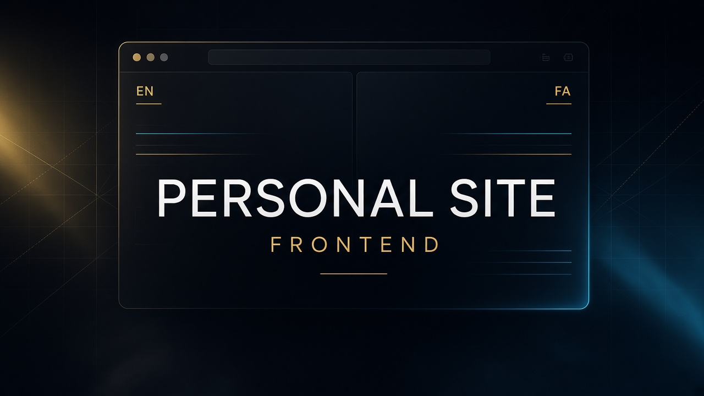

<div align="center">
  
</div>

<p align="center">
  <a href="./README.md">English</a> · <a href="./README.fa.md">فارسی</a>
</p>

<h1 align="center">سایت شخصی — فرانت‌اند</h1>

<p align="center">
  رابط <strong>Next.js 16</strong> با App Router برای سایت برنامه‌نویسی دوزبانه.<br />
  انگلیسی + فارسی (RTL)، next-intl، Tailwind CSS 4، SEO و لایه API تایپ‌شده.
</p>

<p align="center">
  <a href="https://github.com/seyedWebpro/api_backend_personalsite"><strong>ریپوی بک‌اند →</strong></a>
</p>

---

## این فرانت‌اند چه می‌کند

سایت عمومی به‌صورت اپ Next.js با لایه‌بندی فیچر ساخته شده، نه یک پوشه شلوغ از صفحات. زبان، SEO، HTTP و شِل لایوت جدا هستند تا بخش‌های بعدی (پروژه‌ها، مقالات، تماس) بدون بازنویسی اسکلت اضافه شوند.

| قابلیت | توضیح |
| --- | --- |
| روتینگ | App Router با `[locale]` و پیشوند همیشگی زبان |
| چندزبانه | `en` + `fa`، RTL/LTR، Vazirmatn / Geist |
| استایل | Tailwind CSS 4 |
| SEO | متادیتا، sitemap، robots، JSON-LD |
| API | کلاینت Axios و rewrite مسیر `/api/*` به ASP.NET Core |
| کیفیت | ESLint، TypeScript، React Compiler |

## شروع کار

### پیش‌نیاز

- Node.js **20.9+**
- در صورت نیاز به داده زنده، [API بک‌اند](https://github.com/seyedWebpro/api_backend_personalsite)

### ۱. نصب

```bash
npm install
```

### ۲. محیط

```bash
cp .env.example .env.local
```

```bash
NEXT_PUBLIC_API_BASE_URL=http://localhost:5095
NEXT_PUBLIC_SITE_URL=http://localhost:3000
```

### ۳. توسعه

```bash
npm run dev
```

[http://localhost:3000/en](http://localhost:3000/en) یا [http://localhost:3000/fa](http://localhost:3000/fa)

## API همراه

بک‌اند در **[seyedWebpro/api_backend_personalsite](https://github.com/seyedWebpro/api_backend_personalsite)** است — Clean Architecture، ASP.NET Core 10، EF Core، SQL Server.

آدرس محلی API: `http://localhost:5095`  
درخواست‌های `/api/*` به همان مبدأ بازنویسی می‌شوند.

## مجوز

تحت [MIT License](LICENSE) منتشر شده است.
