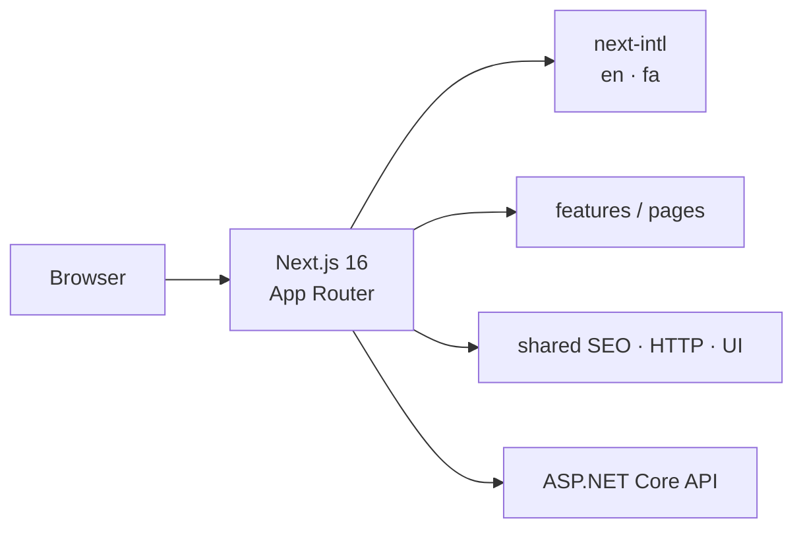

<div align="center">
  
</div>

<p align="center">
  <a href="./README.md">English</a> · <a href="./README.fa.md">فارسی</a>
</p>

<h1 align="center">Personal Site — Frontend</h1>

<p align="center">
  <strong>Next.js 16</strong> App Router UI for a bilingual personal programming site.<br />
  English + فارسی (RTL), next-intl, Tailwind CSS 4, SEO, and a typed ASP.NET Core API layer.
</p>

<p align="center">
  <a href="https://github.com/seyedWebpro/front_personalsite/actions/workflows/ci.yml"></a>
  <a href="./LICENSE"></a>
  
  
  
</p>

<p align="center">
  <a href="https://github.com/seyedWebpro/api_backend_personalsite"><strong>Backend repository →</strong></a>
</p>

---

## Why this frontend

The public site is built as a **feature-sliced Next.js app**, not a single dump of pages. Locale, SEO, HTTP, and layout stay in shared layers so new sections (projects, articles, contact) plug in without rewriting the shell.

| Capability | Detail |
| --- | --- |
| Routing | App Router with `[locale]` and `localePrefix: always` |
| i18n | `en` + `fa`, RTL/LTR, Vazirmatn / Geist |
| Styling | Tailwind CSS 4 |
| SEO | Metadata, sitemap, robots, JSON-LD |
| API | Axios client, `/api/*` rewrite to ASP.NET Core |
| Quality | ESLint, TypeScript, React Compiler |

## Architecture



```
src/
├── app/                 Routes, layouts, sitemap, robots
├── components/layout/   Header, locale switch
├── features/            Page-level views
├── i18n/                Routing and translation wiring
├── messages/            en.json · fa.json
├── config/              Site + Axios
└── shared/              SEO, HTTP, fonts, types
```

## Tech stack

- **Next.js 16** / **React 19** / **TypeScript 5**
- **next-intl** for locales and RTL
- **Tailwind CSS 4**
- **Axios** for the public API
- Security headers (`X-Frame-Options`, `Referrer-Policy`, `Permissions-Policy`)

## Getting started

### Prerequisites

- Node.js **20.9+**
- The [backend API](https://github.com/seyedWebpro/api_backend_personalsite) running if you need live data

### 1. Install

```bash
npm install
```

### 2. Environment

```bash
cp .env.example .env.local
```

```bash
NEXT_PUBLIC_API_BASE_URL=http://localhost:5095
NEXT_PUBLIC_SITE_URL=http://localhost:3000
```

### 3. Develop

```bash
npm run dev
```

Open [http://localhost:3000/en](http://localhost:3000/en) or [http://localhost:3000/fa](http://localhost:3000/fa).

### Scripts

| Command | Purpose |
| --- | --- |
| `npm run dev` | Development server |
| `npm run build` | Production build |
| `npm run start` | Serve the production build |
| `npm run lint` | ESLint |
| `npm run typecheck` | `tsc --noEmit` |

## Companion API

The backend is **[seyedWebpro/api_backend_personalsite](https://github.com/seyedWebpro/api_backend_personalsite)** — Clean Architecture, ASP.NET Core 10, EF Core, SQL Server.

Local API: `http://localhost:5095`  
Requests to `/api/*` on this app are rewritten to that origin.

## Contributing

See [CONTRIBUTING.md](CONTRIBUTING.md). Security reports go to [SECURITY.md](SECURITY.md).

## License

Released under the [MIT License](LICENSE).
